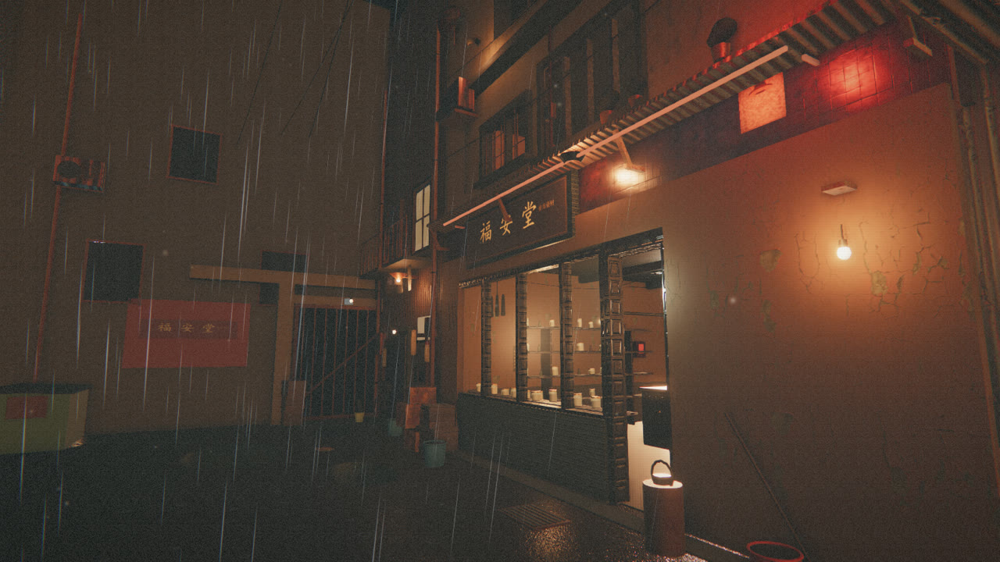
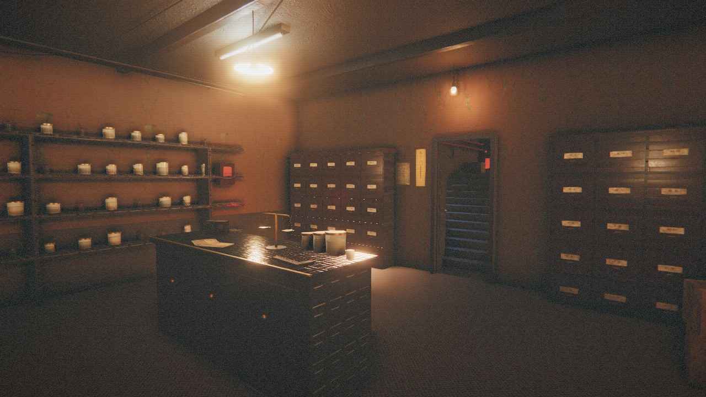
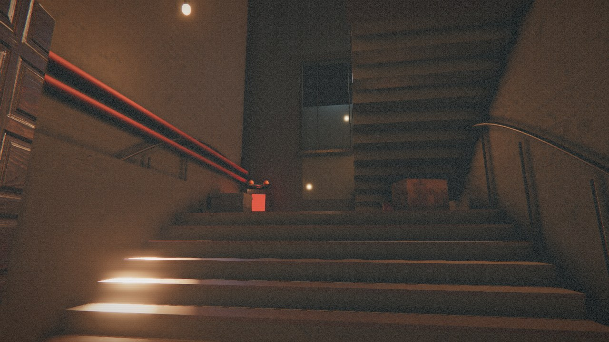
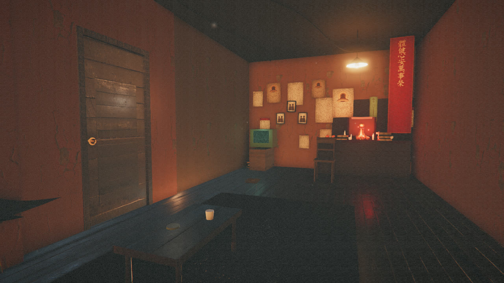
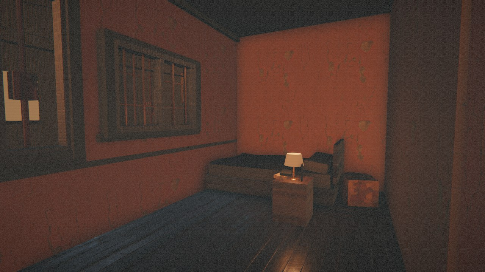
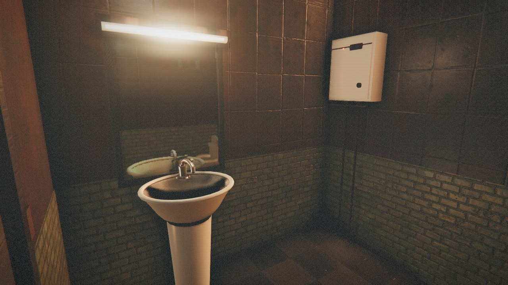

<div align="center">

# 回南 · HUI NAM

**一九八七年，深水埗。雨落咗成晚。三樓，有人等緊你。**

港式唐樓第一人稱恐怖 Demo · three.js / WebGL2 · 五個自由行走空間

[**▶ 線上遊玩**](https://cl0ud-99.github.io/hui-nam-demo/) · [操作](#操作) · [技術重點](#技術重點) · [更新日誌](#更新日誌)

</div>

---

## 截圖

<table>
<tr>
<td width="50%"></td>
<td width="50%"></td>
</tr>
<tr>
<td></td>
<td></td>
</tr>
<tr>
<td></td>
<td></td>
</tr>
</table>

---

## 即刻玩

**線上**：<https://cl0ud-99.github.io/hui-nam-demo/>

**本機（推薦）**：雙擊 `Play.bat`，會自動開本地伺服器同瀏覽器。

或者：

```bash
node server.js --open     # http://localhost:8777/
```

> 建議用 Chrome / Edge，佩戴耳機。含閃爍光源與驚嚇內容。

---

## 操作

| 按鍵 | 動作 |
|---|---|
| `W A S D` | 行走 |
| `Shift` | 快走 |
| 滑鼠 | 環視（點擊畫面鎖定滑鼠） |
| `E` | 互動（開門、上香、開水喉、望鏡） |
| `F` | 電筒 |
| `Esc` | 暫停 / 返回 |
| `F3` | 效能資訊（幀時間、draw call、program 數） |

主目錄可以揀 **開始**、**宣傳片**（64 秒自動運鏡）、**畫質**（高／中／低）。

---

## 場景

一條濕滑後巷 → 福安堂藥行 → 後樓梯 → 三樓陳宅（廳、神檯、睡房）→ 浴室。
全部房間可以自由行入，門可以開關，樓梯可行上三樓。

恐怖節拍：上樓梯時嘅人影、神檯三炷香、鏡裡面嘅「人」、結尾。

---

## 技術重點

- **three.js r169 + WebGL2**，自訂後處理鏈：GTAO → Bloom → ACES 色調映射 → 膠片顆粒／暗角／色差 → SMAA
- **平面反射**：浴室鏡、衣櫃鏡以獨立 RT 做 planar reflection（鏡頭反轉 + 斜裁剪平面），螢幕空間 UV 取樣；室內外地面已改為純材質濕感，低頭唔會再出現燈光殘影
- **PBR 材質**：Poly Haven CC0 掃描貼圖（2K albedo / normal / roughness），按真實尺寸（米）做 UV；材質按用途分組（門／門套／藥櫃／傢俬／神檯／地板／室外雜木），唔再全屋同一塊木紋
- **濕地水窪**：puddle mask + 法線動畫 + 體積霧 + 雨絲 instancing + 漣漪 shader
- **光影**：每間房固定 **14 盞點光 + 1 盞聚光**（唔夠就補 0 強度虛擬燈），全場只有一套 shader 變體；換房唔會重新編譯
- **陰影**：每間房只有主燈投影，shadow map 只喺換房／開門時重繪（`shadowMap.autoUpdate = false`）
- **預熱**：啟動時對每個房間六方向 `compile` + 完整 composer，並強制跑一次鏡面反射，避免行入新房間時爆格
- **靜態合併**：按材質合併靜態幾何，約 1,700 mesh → 230 桶
- **程序化音效／美術**：WebAudio 合成雨聲、光管嗡鳴、木門吱呀、水滴、心跳、耳語、驚嚇音；揮春、海報、招牌、日曆、藥屜標籤、符咒全部用 Python + PIL 生成
- **實測**（RTX 4070 Laptop / 1600×900）：後巷中位 8.5 ms、藥行 4–6 ms、三樓 5.6 ms；五段連續切換 **0 幀 > 28 ms**，shader program 全程 82；連續掉幀自動降一檔

---

## 檔案結構

```
hui-nam-demo/
├── Play.bat                 雙擊即玩
├── index.html               外殼、UI、主目錄
├── server.js                本地靜態伺服器（port 8777）
├── dist/bundle.js           esbuild 打包後嘅遊戲
├── src/
│   ├── main.js              啟動、載入、遊戲狀態機
│   ├── pv.js                宣傳片運鏡時間表
│   ├── core/
│   │   ├── engine.js        renderer + composer + 畫質
│   │   ├── reflector.js     平面反射 + wetify() 注入
│   │   ├── materials.js     所有 PBR 材質（按用途分組）
│   │   ├── textures.js      貼圖載入、真實尺寸 tiling
│   │   ├── props.js         傢俬／道具／燈具 parametric builders
│   │   ├── player.js        第一人稱控制、碰撞、互動 raycast
│   │   ├── audio.js         程序化音效引擎
│   │   └── gradeShader.js   ACES + 調色 shader
│   ├── world/
│   │   ├── world.js         場景總管、燈光、反射、雨、塵、碰撞
│   │   ├── alley.js         後巷
│   │   ├── shop.js          福安堂藥行
│   │   ├── stairs.js        後樓梯
│   │   ├── apartment.js     三樓單位
│   │   ├── bathroom.js      浴室 + 鏡
│   │   ├── story.js         劇情／互動節拍
│   │   └── buildutil.js     牆身開洞、collider 工具
│   └── ui/ui.js             HUD、字幕、fade、letterbox
├── assets/
│   ├── tex/                 19 組 CC0 PBR 貼圖（2K）
│   ├── art/                 程序化生成嘅海報、招牌、decal
│   └── env/night_street.hdr 環境反射
├── screenshots/             README 用截圖
└── tools/
    ├── build.mjs            esbuild 打包（src -> dist/bundle.js）
    ├── capture.mjs          零依賴 CDP 截圖 / 批量機位 / 自動斷言
    ├── shots.json           7 個固定機位（後巷…浴室）
    └── genart.py            重新生成所有 2D 美術
```

---

## 重新建置

```bash
npm install            # 只第一次（three r169 + esbuild）
npm run build          # 打包 src -> dist/bundle.js
npm run serve          # 開伺服器（port 8777）
node server.js --open  # 開伺服器並開瀏覽器
```

修改 `src/` 之後執行 `npm run build` 即生效。

**截图 / 回归检查（新增）**

```bash
# 单张：用 ?shot=x,y,z,lookX,lookY,lookZ 固定机位
node tools/capture.mjs --out shots/a.png \
  --url "http://localhost:8777/?shot=-2,1.55,10.2,0.2,1.9,5.4" \
  --seed 1234

# 批量：7 个固定机位（后巷 / 店面 / 药行 / 楼梯 / 三楼 / 神檯 / 浴室）
node tools/capture.mjs --batch tools/shots.json
```

`--seed` 固定 `Math.random`，同一 seed 下两次渲染可以逐像素对比，用来验证改动。

重新生成 2D 美術：

```bash
python tools/genart.py
```

---

## 更新日誌

### 2026-11-06（深夜 · 二樓可讀性、門芯板、熱水器）
- **地板與地毯提亮**：`floorApt` albedo 再推到 `0xe2c398`、roughness 0.72、env 0.42，並在廳中央加一盞暖色地面反射補光（`0xffa25c / 4.2 / 4.2m`）；地毯改**程序化貼圖**（原本 `dirty_carpet` 掃描反照率只有 0.20，任何染色乘上去都是黑的，整間房中央像個洞）
- 實測（同一機位）：前景地板亮度 44.1→49.0、R−B −0.4→**+15.7**；地毯中心 47.6→**54.6**、R−B −2.0→**+21.4**
- **門芯板材質**：`makeDoor` 原本把凸起板硬綁 `M.doorInset`（灰漆），四扇門都像灰石磚；改為由門扇材質派生（乘 0.84、roughness +0.06），紅漆門／暖木門／淺漆浴室門各自協調
- **熱水器重做**：封閉箱體 + 前置面板 + 黑色視窗 + 旋鈕 + 紅色指示燈，兩根水管沿牆落到地面，不再像敞開的櫃子
- 自檢：客廳／地毯／門／熱水器四個機位截圖；全流程 `ended: true`（僅 headless pointer-lock 提示）、五段切換 0 幀 > 28 ms、programs 88

### 2026-11-06（晚 · 浴室地面與潔具）
- **浴室地面**：原本用 `dirty_tiles`，UV 被拉成長條，讀起來似木地板；改用方形陶瓷磚（`floor_tiles_06`，0.42 m 一格、棋盤色差），roughness 0.44 保留濕潤反光
- **地板被蓋住**：全屋地板平面覆蓋浴室footprint 且高 2 mm，浴室地板一直藏喺下面（所以見到嘅係睡房木地板）；浴室地板抬到 `y0+0.016`
- **馬桶重做**：方形底座改錐形陶瓷柱 + 外撇腳座，加圈沿、坐圈、立起蓋板同鉸位，近看唔再似紙箱
- 自檢：浴室四個機位截圖（俯視／門口／廣角／貼牆），0 疊面、0 木地板殘留；全流程 `ended: true`、五段切換 0 幀 > 28 ms、programs 88

### 2026-11-06（晚 · B 組：可讀性與接觸陰影）
- **三樓可讀性**：客廳主燈 8→10.5、床頭燈 5→9.5、補光移到廳中央（-0.2, 1.58, 2.0 / 9 / 8.5）、窗口冷光 3.2→6、地板 albedo 提亮（0xab8a5f→0xcaa97a）；實測地面木紋與家具輪廓可辨
- **接觸陰影**：GTAO 加強（blend 1.0→1.55、radius 0.42→0.7、scale 1.0→1.6）；開/關對比 mean 差 8.7/255，櫃檯底部、洗手台底座、膠桶邊緣有暗角
- **藥行燈管**：`fluorescent()` 加磨砂套管、`tubeGreen` 自發光 4→2.2，近睇唔再係一條硬綠棒

### 2026-11-06（下午 · 畫面與門）
- **開局視角**：主選單背景同點擊「開始」後嘅機位完全一致（同一位置、朝向、1.62 m 視高），`startGame()` 直接接手選單相機姿態，切換零跳變
- **藥行**：天花光霧收斂（燈泡 44→26、下移、自發光 2.4→1.45）；櫃檯由純黑提亮（0x40503f→0x59684f、roughness .68→.55）並加銅邊；藥屜標籤放大到 0.205×0.068 m，加 `emissiveMap` 微光，暗光下可讀
- **後巷**：濕地高光收斂（roughness .24→.33、metalness .22→.12），右下白斑不再過曝；鐵皮雨棚補三根牆→外沿斜撐同牆板，唔再懸空
- **樓梯**：踏步前緣由拋光金屬改啞光金屬條，唔再被燈泡打成白線
- **牆面**：污漬／霉斑改受光材質（Standard + `emissiveMap` 0.3），貼圖邊緣羽化 30 px；每面牆隨機 UV 偏移，瓷磚／木板重複感下降
- **浴室**：洗手盆改一體成型車削盆體（LatheGeometry）；龍頭按真實單柄鵝頸款重做（底座／柱身／彎管／出水嘴／起泡器／側柄／水柱）；燈管加磨砂罩並壓低自發光；修好牆角共面 z-fighting（牆面內移 4–6 mm）；刪掉穿牆小凳
- **門**：四扇門正反面都有兩塊帶倒角凸起裝飾板 + 銅橫柄／圓座／鑰匙孔飾片，背面唔再係光板

### 2026-11-06
- **浴室重建**：四面牆改為 12 cm 實體盒體（內側瓷磚、外側與全屋一致嘅灰泥），門洞／門框／門扇三者對齊；補回浴室後方死角，牆身拉直到天花
- **入浴室卡頓**：光源預算漂移令 12 個 shader 重編譯（單幀 7.8 秒）→ 每房固定 14 點光 + 1 聚光、投影燈唯一化，換房零重編譯；鏡面反射預熱
- **窗**：臥室大窗、小窗與外立面開洞逐一對齊（鏡像牆局部座標換算），內外都見到對面街景；刪除黑窗簾與浴室透明浴簾
- **地面反射**：室內外一律關閉平面反射，低頭唔再有燈光殘影；濕感改由材質表現
- **材質分組 A–E**：紅漆入戶門／暖木睡房門／淺漆浴室門、漆面門套與窗框、酸枝藥櫃 + 淺色抽屜 + 墨綠防火板櫃檯 + 粗木樑 + 鐵皮招牌背板、松木凳椅／胡桃木枱／雙色衣櫃／夾板電視櫃、神檯紅漆、地板與室外雜木
- 樓梯踏步板與結構台階共面造成嘅閃爍修復；多處浮空污漬貼花清除

### 2026-11-05
- 後巷封閉化、立面細節、雨漣漪、濕地反射
- 光照重平衡、每房燈光規格化、反射 30 Hz、指針鎖定防抖
- 全屋碰撞體與導航驗證（0.1 m 網格洪水填充）

---

## 已知限制

- 這是 **demo 場景**，唔係完整遊戲：一條主線、約 5–8 分鐘流程、一個結局。
- 高畫質需要獨立顯示卡；如果 fps 低，主目錄揀「畫質 → 中／低」（亦會自動降檔）。
- 字體用系統中文字型（宋體／楷體），唔同 Windows 版本可能略有差異。
- 畫面刻意做舊：泛黃色偏、菲林顆粒、輕微閃爍與偶發劃痕（`src/core/gradeShader.js` 的 `uAged` / `uGrain`）；接受唔到可以 `?aged=0&grain=0` 關掉。
- 怕驚嚇可以用主目錄 **「模式 → 溫和」**（或 `?story=1`）：保留全部字幕同劇情，只抽起跳嚇、尖叫同震動。

---

## 關於

一九八七年的深水埗，一個返夜歸嘅故事。場景、道具、貼圖排布、音效都係程序化生成或者 CC0 素材，冇用第三方模型。

- 引擎：three.js r169 + WebGL2，自訂後處理鏈（GTAO → Bloom → ACES → 舊片調色 → SMAA）
- 時長：5–8 分鐘，單結局，冇失敗判定
- 平台：桌面 Chrome / Edge（需要 WebGL2）；手機可以開，但畫質同操作唔保證
- 授權：demo 用途；貼圖 Poly Haven CC0，其餘自製

*Made with three.js. Textures: Poly Haven (CC0). Everything else procedural.*
